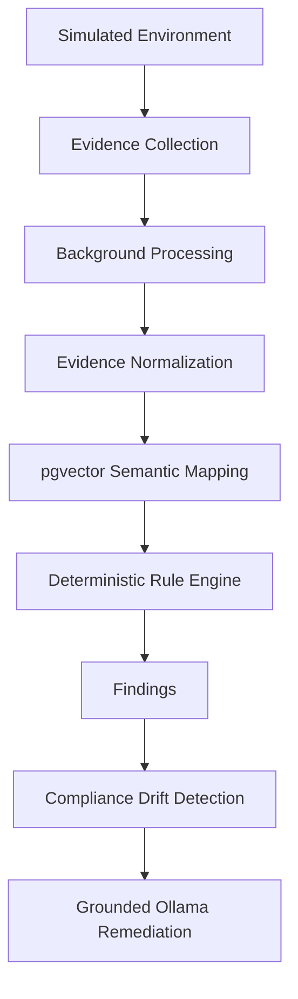

# Intelligent Cyber Compliance Tracker

## Overview

This project is a backend MVP for an intelligent cyber compliance tracker. It simulates an enterprise environment, collects evidence from users, repositories, servers, cloud buckets, and backups, maps that evidence to controls using semantic similarity, applies a deterministic compliance rule engine, and creates findings and compliance drift records.

## Why AI does not decide compliance

The application follows a strict architecture where deterministic backend logic decides PASS/FAIL/UNKNOWN. The LLM is used only for grounded explanation and remediation suggestions after the compliance result is already known. This avoids nondeterministic compliance decisions and keeps the model focused on explaining evidence and recommending changes.

## Architecture



## Technology stack

- Python 3.10+
- FastAPI
- SQLAlchemy 2
- PostgreSQL + pgvector
- Uvicorn
- Sentence Transformers
- Ollama
- Pytest

## Local setup

1. Create a virtual environment.
2. Install dependencies with `pip install -r requirements.txt`.
3. Create a `.env` file from `.env.example`.
4. Start PostgreSQL and enable the `vector` extension.
5. Start Ollama and ensure the model is available via `ollama pull qwen8:3b`.
6. Run `uvicorn app.main:app --reload`.

## PostgreSQL and pgvector

```sql
CREATE EXTENSION IF NOT EXISTS vector;
CREATE DATABASE cyber_compliance;
```

Update the `DATABASE_URL` in `.env` accordingly before starting the service.

## Ollama setup

```bash
ollama pull qwen8:3b
```

The app uses `OLLAMA_BASE_URL` and `OLLAMA_MODEL` from environment variables. If Ollama is unavailable, the fallback remediation provider generates deterministic guidance without failing the app.

## Demo workflow

1. Start the app.
2. Open `/docs`.
3. POST `/api/v1/demo/seed`.
4. POST `/api/v1/demo/collect-evidence`.
5. POST `/api/v1/demo/run-compliance-check`.
6. Review `/api/v1/evidence`, `/api/v1/mappings/evidence/{id}`, `/api/v1/evaluations`, `/api/v1/findings`, and `/api/v1/audit-logs`.
7. Call POST `/api/v1/remediation/findings/{finding_id}`.
8. Execute a safe action via POST `/api/v1/remediation/actions/{finding_id}`.
9. Review drift via GET `/api/v1/drift`.

## Testing

```bash
pytest -q
```

## Future scope

- Real cloud connectors
- GitHub API integration
- AWS Security Hub
- Redis or Celery workers
- Enterprise RBAC
- Multi-tenant architecture
- Continuous scheduled monitoring
- Additional compliance frameworks
- Large-scale remediation workflows
